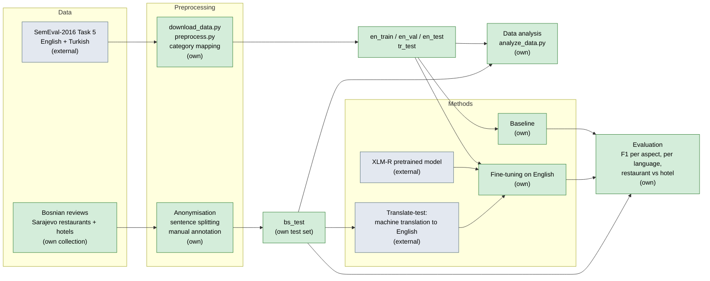

# Cross-Lingual Aspect-Based Sentiment Analysis of Tourist Reviews of Sarajevo Restaurants and Hotels

NLP course project – Topic 6: Tourist review aspect analysis

## Team
- Merima Balihodžić – Merima667
- Medina Alić – medina1908
- Selma Melunović– SelmaMelunovic

## Topic
We detect which aspects (food, staff, price, location) tourists mention in reviews of
Sarajevo restaurants and hotels, and whether they praise or criticise them.
We test whether a model trained on English reviews works on Bosnian and other
languages without retraining.

## Status
## Research question
Does an aspect model trained on English reviews work on Bosnian and other languages
without retraining?

## Data
- Training: SemEval-2016 Task 5, English restaurant reviews
- Testing: SemEval-2016 English and Turkish restaurant reviews, and our own annotated
  Bosnian reviews of Sarajevo restaurants and hotels

Details about the data, the license and the category mapping: see [`data/README.md`](data/README.md).

## Installation
Requires Python 3.12.

    pip install -r requirements.txt

## How to run
Run all commands from the project root, in this order:

    python src/download_data.py      # downloads SemEval-2016 data to data/raw/
    python src/preprocess.py         # cleans, maps categories, splits data -> data/processed/
    python src/analyze_data.py       # tables and charts -> results/data_analysis/

The random seed is fixed (`SEED = 42` in `src/preprocess.py`), so the split is always the same.

## Repository structure

    data/          data instructions; raw/ and processed/ are not in the repository
    src/           Python scripts
    results/       tables, charts and model results
    docs/          AI log, annotation guidelines, pipeline diagram
    notebooks/     experiments

## Pipeline

Green: our own work. Grey: external data, models or services.

## Status
Milestone 3: data, preprocessing and data analysis done; baseline and Bosnian test set in progress.
